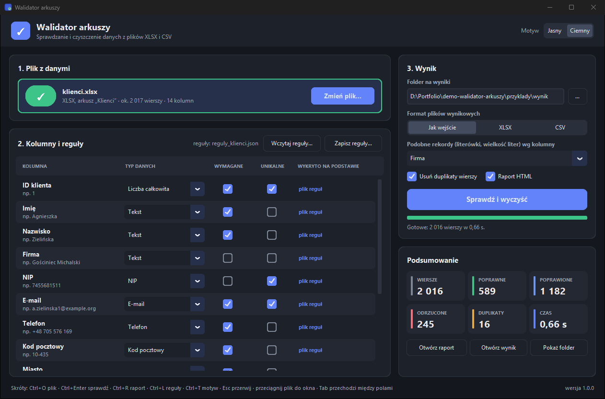
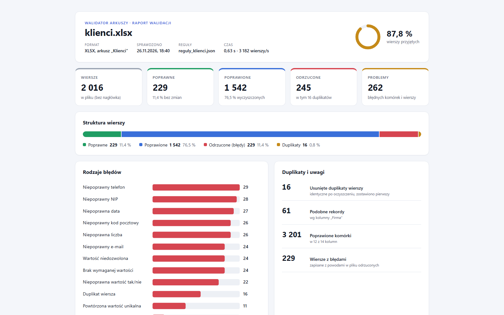
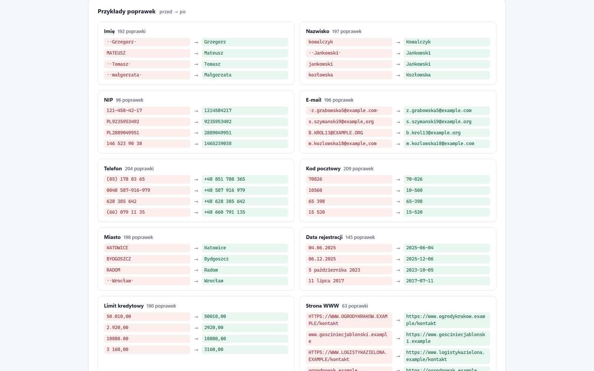

# Walidator arkuszy

*English summary: a Windows desktop and command-line tool (Python) that validates and cleans messy XLSX/CSV files with Polish data (NIP, phone numbers, postal codes, dates, amounts) and produces a cleaned file, a file of rejected rows with reasons, and a self-contained HTML report.*

Program do sprawdzania i czyszczenia danych z arkuszy. Wczytuje „brudny” plik XLSX lub CSV,
rozpoznaje typy kolumn, poprawia to, co da się poprawić automatycznie, i zapisuje:

- **plik z czystymi danymi** (w tym samym formacie co wejście albo w XLSX/CSV),
- **plik z odrzuconymi wierszami** – z oryginalnymi wartościami, błędne komórki zaznaczone na czerwono, z kolumną „Powody odrzucenia”,
- **raport HTML** – jeden samodzielny plik z podsumowaniem, wykresem rodzajów błędów, statystykami kolumn, przykładami poprawek i listą problemów (gotowy do wydruku do PDF).

W plikach CSV tekst zaczynający się od `=`, `+`, `-` lub `@` dostaje na początku apostrof, żeby arkusz nie uruchomił go
jako formuły (liczby, np. „-12,50”, zostają bez zmian; XLSX zapisuje takie wartości zawsze jako tekst). Wyniki powstają
najpierw w plikach tymczasowych: jeśli poprzedni wynik jest otwarty w Excelu, program to zgłasza i nie zmienia starych plików.

Program działa jako okno (Windows) i z wiersza poleceń. Oba interfejsy korzystają z tej samej biblioteki.


| Motyw ciemny | Raport HTML |
| --- | --- |
|  |  |



## Co potrafi

**Wczytywanie**
- XLSX (także XLSM, XLS, ODS) i CSV/TXT/TSV.
- CSV: automatyczne rozpoznanie kodowania (UTF-8 z BOM i bez, Windows-1250, ISO-8859-2) i separatora (`;` `,` tabulator `|`) – także gdy w danych są przecinki dziesiętne.
- Nagłówek nie musi być w pierwszym wierszu, puste wiersze są pomijane, powtórzone nazwy kolumn dostają numer.
- Ostrzeżenia w raporcie i w podsumowaniu: plik z mieszanym kodowaniem (znaki „�”), skoroszyt z kilkoma arkuszami
  (sprawdzany jest pierwszy, inny: `--arkusz`), wiersze z mniejszą liczbą pól niż nagłówek (brakujące pola są puste;
  wiersze z nadmiarowymi polami są odrzucane).

**Typy kolumn** – wykrywane z nazwy nagłówka i zawartości, do zmiany w oknie lub w pliku reguł:

| Typ (w regułach) | Co sprawdza i jak czyści |
| --- | --- |
| `tekst` | zbędne spacje; opcjonalnie wielkość liter („NOWE MIASTO NAD PILICĄ” → „Nowe Miasto nad Pilicą”) |
| `liczba_calkowita` | „1 200”, „1.200”, „12,0” → 1200 / 12 |
| `kwota` | „1 234,56 zł”, „1.234,56”, „1,234.56” → 1234,56; zaokrąglenie do N miejsc (samo dopisanie zer, „5” → „5,00”, nie liczy się jako poprawka) |
| `data` | 01.02.2026, 1/2/2026, 2026-02-01, „1 lutego 2026” → 2026-02-01; wykrywa 31.02, zapis MM/DD i godziny typu 25:99; z daty z godziną zostaje sama data, a raport ostrzega, w ilu komórkach |
| `email` | małe litery, usuwa spacje i „mailto:”, poprawia przecinek przed domeną; wykrywa brak @, polskie znaki, „..” |
| `telefon` | polskie numery z +48 / 0048 lub bez → komórkowe „+48 600 123 456”, stacjonarne z numerem kierunkowym „+48 22 123 45 67”; za mało cyfr, numer zagraniczny |
| `kod_pocztowy` | „00950”, „00 950”, liczba 950 z Excela → „00-950” |
| `nip` | usuwa „PL”, kreski i spacje, sprawdza **cyfrę kontrolną**, odrzuca same takie same cyfry (0000000000) |
| `url` | dodaje brakujące https://, małe litery w domenie |
| `tak_nie` | tak/nie, T/N, 1/0, prawda/fałsz, x → „tak”/„nie” |

**Identyfikatory zostają tekstem:** kolumny typu ID, Nr, Numer oraz wartości z zerem na początku („000123”, PESEL)
lub dłuższe niż 15 cyfr (numery kont) nie są zamieniane na liczby, więc zera i wszystkie cyfry zostają
(wyjątek: nagłówek wskazujący liczbę, np. „Kwota” – tam taka wartość jest błędem).
Liczby dłuższe niż 15 cyfr (ustawione ręcznie jako liczba) trafiają do XLSX jako tekst, bo Excel zaokrągliłby je.

**Reguły dla kolumny:** wymagane, unikalne, min/max (liczby, daty, długość tekstu), lista dozwolonych wartości
(dopasowanie bez względu na wielkość liter, zapis ujednolicony do wersji z listy), wielkość liter, liczba miejsc po przecinku.

**Duplikaty:** identyczne wiersze (po oczyszczeniu) są usuwane – zostaje pierwszy. **Podobne zapisy** według wybranej kolumny –
wartości równe po pominięciu wielkości liter, polskich znaków, spacji, interpunkcji i formy prawnej (np. „Zielony Kłos Sp. z o.o.”
i „ZIELONY KŁOS SP Z OO”) – są pokazywane w raporcie do sprawdzenia. To nie jest wyszukiwanie literówek.

**Reguły w pliku JSON** – raz ustawione sprawdzenie można powtarzać na kolejnych plikach. Błędy w pliku reguł są
opisane po polsku, wszystkie naraz, z podpowiedzią („Nieznane pole „wymagny” w kolumnie „NIP”. Czy chodziło o „wymagane”?”).

## Uruchomienie

### Gotowy program (.exe)

Pobierz `WalidatorArkuszy-1.0.0-windows.zip` z zakładki
[Releases](https://github.com/Gordiv/demo-walidator-arkuszy/releases/latest) i rozpakuj.
Folder `WalidatorArkuszy` zawiera dwa programy (nie wymagają instalacji Pythona):

- `WalidatorArkuszy.exe` – okno programu,
- `walidator.exe` – wiersz poleceń (te same opcje co niżej).

Plik można też przeciągnąć na `WalidatorArkuszy.exe` – otworzy się od razu w oknie.

### Z kodu źródłowego

Wymagany Python 3.12 lub nowszy (testowane na 3.14, Windows 11).

```powershell
py -3.14 -m venv .venv
.venv\Scripts\python -m pip install -e ".[dev]"     # biblioteka, okno, testy i narzędzia
.venv\Scripts\walidator-gui                          # okno programu
.venv\Scripts\walidator przyklady\klienci.xlsx       # wiersz poleceń
```

Sam rdzeń z wierszem poleceń: `pip install -e .`; z oknem: `pip install -e ".[gui]"` (bez tego `walidator-gui`
wyświetla komunikat z tym poleceniem).

## Okno programu

1. **Plik z danymi** – „Wybierz plik…” albo przeciągnij plik do okna.
2. **Kolumny i reguły** – wykryty typ każdej kolumny (lista do zmiany), „Wymagane”, „Unikalne”, przykład wartości
   i informacja, skąd wziął się typ (nagłówek, zawartość, plik reguł). „Wczytaj reguły…” / „Zapisz reguły…”.
3. **Wynik** – folder (domyślnie `wynik` obok każdego otwartego pliku; folder wybrany ręcznie zostaje), format,
   kolumna do szukania podobnych zapisów, usuwanie duplikatów, raport HTML.
4. **Sprawdź i wyczyść** – praca w tle z paskiem postępu (okno nie zamarza, Esc przerywa), potem podsumowanie
   i przyciski „Otwórz raport”, „Otwórz wynik”, „Pokaż folder”.

Skróty: `Ctrl+O` plik, `Ctrl+Enter` / `F5` sprawdź, `Ctrl+R` raport, `Ctrl+L` / `Ctrl+S` wczytaj / zapisz reguły,
`Ctrl+T` motyw jasny/ciemny, `Esc` przerwij. Wszystkie przyciski, pola wyboru i listy są dostępne klawiszem Tab
(widoczna obwódka), Spacja/Enter je uruchamia, strzałki zmieniają wartość listy. Okno skaluje się na ekranach o
wysokiej rozdzielczości. Błędy są opisane po polsku; szczegóły techniczne trafiają do pliku
`%LOCALAPPDATA%\WalidatorArkuszy\walidator.log`.

## Wiersz poleceń

```powershell
walidator dane.xlsx
walidator zamowienia.csv --reguly reguly.json --wyjscie wynik --format xlsx
walidator klienci.xlsx --tylko-analiza --zapisz-reguly moje_reguly.json   # wykryj typy i zapisz reguły do edycji
walidator duzy.csv -q; echo $LASTEXITCODE                                  # tylko kod wyjścia
```

| Opcja | Znaczenie |
| --- | --- |
| `-r`, `--reguly PLIK.json` | plik reguł; kolumny, których nie opisuje, są wykrywane automatycznie |
| `-o`, `--wyjscie FOLDER` | folder na wyniki (domyślnie `wynik` obok pliku wejściowego) |
| `-f`, `--format` | `jak-wejscie` (domyślnie), `xlsx` albo `csv` |
| `-a`, `--arkusz NAZWA` | arkusz pliku XLSX (domyślnie pierwszy) |
| `--zapisz-reguly PLIK.json` | zapisuje użyte reguły |
| `--tylko-analiza` | pokazuje wykryte kolumny bez sprawdzania całego pliku |
| `--bez-raportu` | bez raportu HTML |
| `-q`, `--cicho` / `-v`, `--szczegolowo` | bez komunikatów / z kolumnami, ostrzeżeniami i pierwszymi problemami |

**Kody wyjścia:** `0` – wszystkie wiersze poprawne (po poprawkach), `1` – część wierszy odrzucono,
`2` – błąd użycia, pliku wejściowego lub pliku reguł. Dzięki temu program łatwo wpiąć w skrypt lub harmonogram zadań.

## Plik reguł

```json
{
  "wersja": 1,
  "opis": "Kartoteka klientów",
  "usun_duplikaty": true,
  "klucz_podobienstwa": "Firma",
  "kolumny": {
    "NIP":             { "typ": "nip", "unikalne": true },
    "E-mail":          { "typ": "email", "wymagane": true, "unikalne": true },
    "Data rejestracji":{ "typ": "data", "min": "2015-01-01", "max": "2026-12-31" },
    "Limit kredytowy": { "typ": "kwota", "min": 0, "max": 100000, "miejsca_po_przecinku": 2 },
    "Miasto":          { "typ": "tekst", "wielkosc_liter": "tytulowe" },
    "Segment":         { "typ": "tekst", "dozwolone": ["detaliczny", "hurtowy", "partner"] }
  }
}
```

| Pole kolumny | Wartości |
| --- | --- |
| `typ` | `tekst`, `liczba_calkowita`, `kwota`, `data`, `email`, `telefon`, `kod_pocztowy`, `nip`, `url`, `tak_nie` |
| `wymagane`, `unikalne` | `true` / `false` |
| `min`, `max` | liczba (dla liczb i kwot), data `"RRRR-MM-DD"` (dla dat), długość (dla tekstu) |
| `dozwolone` | lista tekstów |
| `wielkosc_liter` | `bez_zmian`, `male`, `wielkie`, `tytulowe` |
| `miejsca_po_przecinku` | 0–6 (tylko `kwota`) |

Nazwy kolumn są dopasowywane bez względu na wielkość liter i spacje. Kolumna wymagana przez reguły, której brakuje
w pliku, kończy sprawdzanie czytelnym błędem; brak kolumny opcjonalnej daje ostrzeżenie. Przykłady:
[`przyklady/reguly_klienci.json`](przyklady/reguly_klienci.json), [`przyklady/reguly_zamowienia.json`](przyklady/reguly_zamowienia.json).

## Przykładowe dane

`przyklady/klienci.xlsx` (2 016 wierszy) i `przyklady/zamowienia.csv` (3 018 wierszy, Windows-1250, średnik)
to **fikcyjne** dane z celowo wprowadzonymi błędami każdego rodzaju. Tworzy je deterministyczny generator:

```powershell
.venv\Scripts\python narzedzia\generuj_przyklady.py           # klienci.xlsx i zamowienia.csv
.venv\Scripts\python narzedzia\generuj_przyklady.py --duzy    # dodatkowo duzy_100k.csv do testu wydajności (nie w repozytorium)
```

## Wydajność

Pomiar na AMD Ryzen 9 3900X, Windows 11, Python 3.14 (czas całkowity z raportem HTML):

| Plik | Wiersze | Wynik CSV | Wynik XLSX |
| --- | ---: | ---: | ---: |
| `klienci.xlsx` + reguły | 2 016 | – | 0,6 s |
| `zamowienia.csv` + reguły | 3 018 | 0,2 s | – |
| `duzy_100k.csv` (11 kolumn) | 100 600 | **3,9 s** | 18 s |
| `duzy_100k.xlsx` (14 kolumn) | 100 800 | 10 s | 25 s |

Plik jest czytany i zapisywany strumieniowo (jeden przebieg, wyniki trafiają na dysk na bieżąco), duplikaty
wierszy są rozpoznawane po 16-bajtowym skrócie, a powtarzające się wartości (miasta, statusy, daty) są
sprawdzane raz dzięki pamięci podręcznej. Najwolniejszy jest zapis XLSX – przy bardzo dużych plikach szybszy
jest wynik w CSV (`--format csv`).

## Testy i jakość kodu

```powershell
.venv\Scripts\python -m pytest --cov          # 320 testów, pokrycie rdzenia 97 %
.venv\Scripts\ruff check . ; .venv\Scripts\ruff format --check .
```

Testy obejmują walidatory (w tym sumę kontrolną NIP), parsowanie telefonów, kodów, dat i kwot, wykrywanie
kodowania i separatora, reguły JSON i ich komunikaty, duplikaty i podobne rekordy, zapis CSV/XLSX, raport HTML
(m.in. czy dane są poprawnie zabezpieczone przed wstrzyknięciem HTML), ochronę CSV przed formułami, zachowanie zer wiodących
i długich numerów, zablokowane pliki wyniku, stan okna po wczytaniu pliku, kody wyjścia CLI oraz pełne przejście
na plikach przykładowych.

## Budowanie .exe

```powershell
.venv\Scripts\pyinstaller packaging\walidator.spec --noconfirm
```

Wynik: folder `dist\WalidatorArkuszy` (ok. 34 MB) z `WalidatorArkuszy.exe` i `walidator.exe`, które dzielą
te same biblioteki. Wybrano wariant „jeden folder” – program startuje szybciej niż wersja jednoplikowa i rzadziej
jest błędnie oznaczany przez programy antywirusowe. Pliki `.exe` nie są przechowywane w repozytorium.

## Struktura projektu

```
src/walidator/
  model.py        typy kolumn i reguły (dataclasses)
  cleaners.py     spacje, wielkość liter, klucze porównań
  validators.py   parsery typów: NIP, telefon, kod, data, kwota, e-mail, URL, tak/nie
  detection.py    kodowanie, separator, typ kolumny z nagłówka i zawartości
  readers.py      odczyt XLSX/XLS/ODS i CSV wiersz po wierszu
  rules.py        plik reguł JSON: odczyt, walidacja, zapis
  processing.py   sprawdzenie i oczyszczenie jednej komórki
  engine.py       analiza pliku i jednoprzebiegowe sprawdzenie (duplikaty, unikalność, postęp, przerwanie)
  results.py      statystyki wyniku
  writers.py      strumieniowy zapis CSV i XLSX
  report.py       raport HTML (CSS i SVG w jednym pliku)
  cli.py          wiersz poleceń
  gui/            okno (CustomTkinter): app.py, widgets.py, theme.py
tests/            testy pytest
narzedzia/        generator danych, ikona, zrzuty ekranu
packaging/        konfiguracja PyInstaller
przyklady/        przykładowe pliki i reguły
```

Okno nie zawiera logiki sprawdzania – zbiera ustawienia, uruchamia `engine.run_check` w wątku w tle i pokazuje wynik.

## Biblioteki i licencje

| Biblioteka | Do czego | Licencja |
| --- | --- | --- |
| [python-calamine](https://github.com/dimastbk/python-calamine) | szybki odczyt XLSX/XLS/ODS | MIT |
| [XlsxWriter](https://github.com/jmcnamara/XlsxWriter) | zapis XLSX | BSD-2-Clause |
| [CustomTkinter](https://github.com/TomSchimansky/CustomTkinter) | wygląd okna | MIT |
| [tkinterdnd2](https://github.com/Eliav2/tkinterdnd2) | przeciąganie plików do okna | MIT |
| [darkdetect](https://github.com/albertosottile/darkdetect) | motyw systemu (zależność CustomTkinter) | BSD-3-Clause |
| [packaging](https://github.com/pypa/packaging) | zależność CustomTkinter | Apache-2.0 / BSD-2-Clause |
| [pytest](https://pytest.org), pytest-cov | testy | MIT |
| [Ruff](https://github.com/astral-sh/ruff) | formatowanie i lint | MIT |
| [PyInstaller](https://pyinstaller.org) | budowanie .exe (tylko narzędzie) | GPL-2.0 z wyjątkiem dla bootloadera |
| [Pillow](https://python-pillow.org) | rysowanie ikony (tylko narzędzie) | MIT-CMU |

Pozostałe elementy (raport, wykresy, walidatory) korzystają wyłącznie z biblioteki standardowej Pythona.
Folder z plikami `.exe` zawiera też interpreter Pythona (licencja PSF) oraz Tcl/Tk i tkdnd – każdy na własnej licencji,
której tekst jest w dystrybucji danego projektu.

## Ograniczenia

- Zapis XLSX jest kilka razy wolniejszy niż CSV (ok. 5 tys. wierszy/s) – dla plików powyżej ~100 tys. wierszy lepiej wybrać CSV.
  Arkusz XLSX mieści 1 048 576 wierszy: przy większym wyniku program przerywa z komunikatem, by wybrać CSV.
  Tekst dłuższy niż 32 767 znaków jest w XLSX skracany (z ostrzeżeniem); CSV zachowuje go w całości.
- Sprawdzany jest jeden arkusz skoroszytu (domyślnie pierwszy); w oknie nie ma wyboru arkusza, w wierszu poleceń służy do tego `--arkusz`.
- Daty w formacie z ukośnikami są czytane jako dzień/miesiąc (polski zapis); daty amerykańskie są wykrywane tylko, gdy „miesiąc” jest większy niż 12.
- Telefony: obsługiwane są numery polskie; numery zagraniczne są odrzucane z odpowiednim powodem.
- Liczba wierszy pokazywana przed sprawdzeniem jest szacunkowa (liczba linii pliku); dokładna jest w podsumowaniu.
- Okno działa na Windows 10/11 (na innych systemach działa wiersz poleceń).

## Licencja

MIT © 2026 Gordiv – zobacz [LICENSE](LICENSE).
